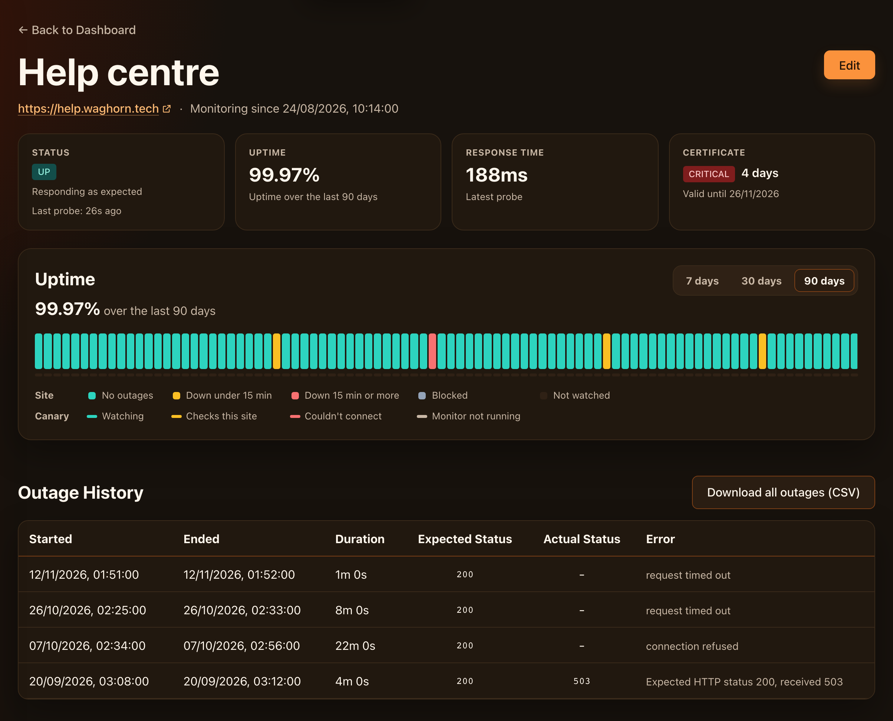
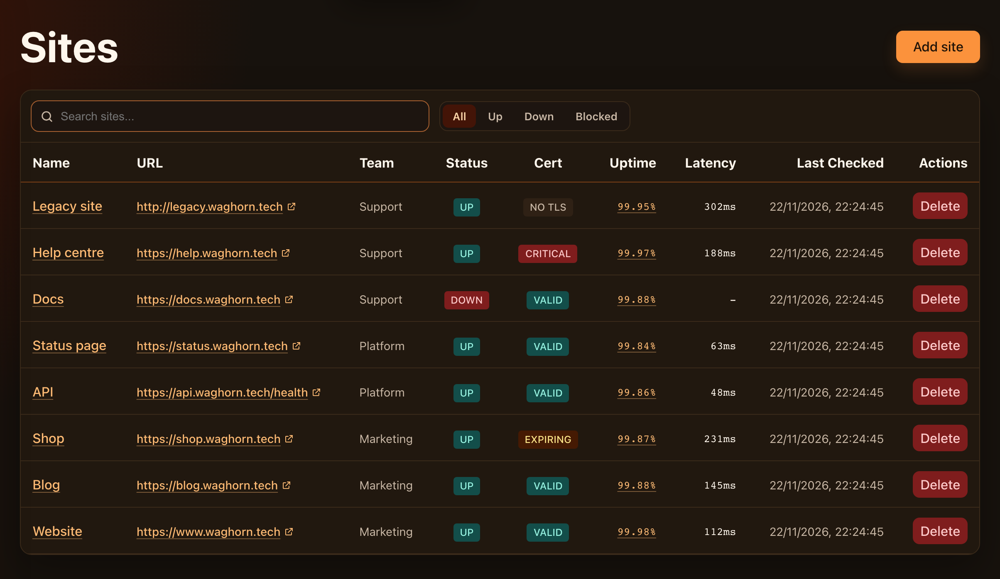
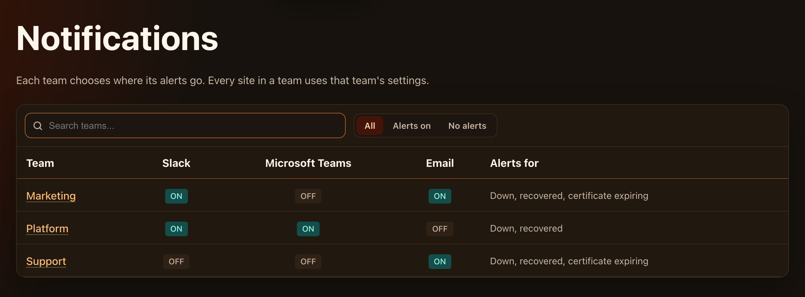

<p align="center">
  
</p>

<h1 align="center">Site Oxidation</h1>

<p align="center">Monitor the oxidation of your site. Prevent rust build up.</p>

Site Oxidation is self-hosted website uptime monitoring with a low memory
footprint. It checks your sites on a schedule and tells you when something goes
wrong. A single Rust binary with SQLite built in, it runs happily on a home
server or small VPS.

- Records outages and response times, with daily uptime history
- Warns before TLS certificates expire
- Sends alerts by email, Slack or Microsoft Teams
- Supports multiple users and teams
- Exports outage history as CSV
- Uses a connectivity canary, so losing your own internet connection is not
  recorded as every site going down

## Screenshots

Each site has its own page with status, response time, certificate expiry,
90 days of uptime and its full outage history.



All your sites at a glance, with filters for what's up, down or blocked.



Each team chooses where its alerts go: Slack, Microsoft Teams or email.



## Quick Start

### Unraid

Install from Community Apps, or with Docker Compose. See
[docs/deployment/unraid.md](docs/deployment/unraid.md) for both, plus HTTPS and
backups.

### Docker Compose

```bash
docker compose up -d --build
```

Open `http://localhost:8026` and follow the setup wizard to create your admin
account.

If running on Docker Desktop, add `BOOTSTRAP_TRUSTED_IPS=172.64.154.55` to your
`.env` file. See [environment variables](docs/environment_variables.md) for all
settings.

## Development

See [docs/development.md](docs/development.md) for prerequisites, running locally, generating
OpenAPI types, building the frontend and using Docker.

Run every lint and test check locally (same as CI):

```bash
prek run --all-files --hook-stage pre-push
```

## Licence

This project is licenced under [GNU AGPL v3.0](LICENSE).
